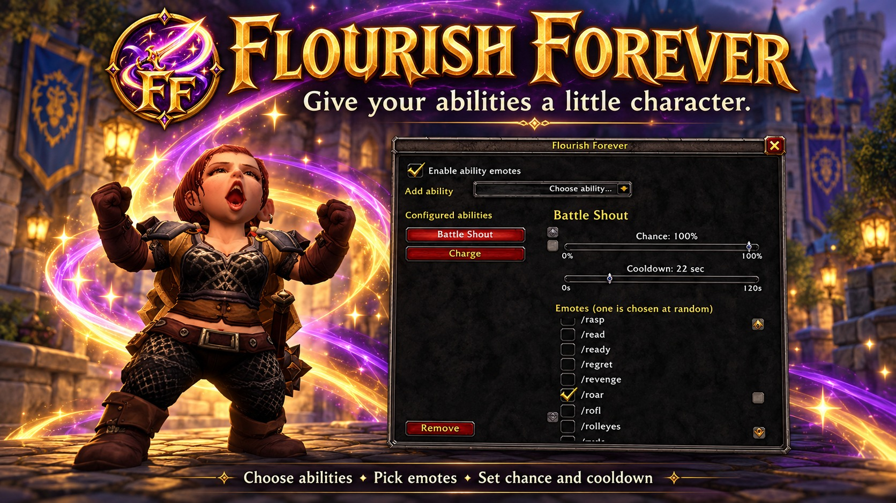

# Flourish Forever — portfolio artwork

These three creator-supplied files are preserved byte-for-byte with URL-safe filenames for the Babuni.dev portfolio. `manifest.json` lists repository-relative paths, roles, dimensions, sizes, original filenames and suggested alt text. It is an asset index, not a claim of integration with an existing portfolio importer.

| File | Role | Dimensions |
| --- | --- | --- |
| [flourish-forever-logo.png](flourish-forever-logo.png) | Square project logo | 1254 × 1254 |
| [flourish-forever-showcase.png](flourish-forever-showcase.png) | Full PNG promotional showcase | 1672 × 941 |
| [flourish-forever-thumbnail.jpg](flourish-forever-thumbnail.jpg) | Preferred web/card preview; 481,703 bytes, below 2 MB | 1672 × 941 |

## Display URLs

- Logo: https://raw.githubusercontent.com/babunidev/FlourishForever/main/assets/portfolio/flourish-forever-logo.png
- Showcase: https://raw.githubusercontent.com/babunidev/FlourishForever/main/assets/portfolio/flourish-forever-showcase.png
- Preview: https://raw.githubusercontent.com/babunidev/FlourishForever/main/assets/portfolio/flourish-forever-thumbnail.jpg

The creator requested branding consistent with their other Forever addons, accepted the logo, supplied screenshots for the promotional composition, and requested a thumbnail below 2 MB. AI assisted with the imagery and export. The showcase is promotional artwork based on screenshots, not an unedited screenshot or evidence of runtime testing. Game imagery retains its respective ownership; storing these files does not establish a new license.

